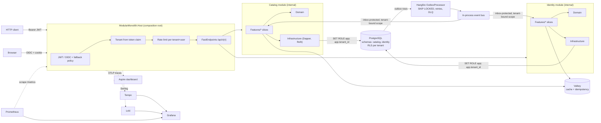

# ModularMonolith V1

A .NET 10 **modular monolith** template using **vertical slices** inside each module. Each module enforces clean-architecture dependency rules at its own boundary.

**Stack:**
- **Hosting:** ASP.NET Core with FastEndpoints, Aspire for local orchestration
- **Data:** PostgreSQL (Dapper, DbUp, row-level security) and Valkey
- **Messaging:** Hangfire runs a transactional outbox and inbox
- **Identity:** Keycloak over OpenID Connect and JWT
- **Observability:** OpenTelemetry, Serilog, Grafana, Tempo, Loki and Prometheus

Every dependency is free and open source (see [Third-party licenses](#third-party-licenses)).

---

## Quickstart

```powershell
# Build (warnings are errors, analyzers on)
dotnet build ModularMonolith.slnx

# Install as a `dotnet new` template
dotnet new install .
dotnet new modular-monolith -n MyCompany.Platform

# Run everything with Aspire (PostgreSQL, Valkey, Keycloak, LGTM, API)
# You'll be asked for the secret parameters in the dashboard, or set them once:
dotnet user-secrets --project src/Aspire/ModularMonolith.AppHost set "Parameters:postgres-password" "<pick one>"
dotnet user-secrets --project src/Aspire/ModularMonolith.AppHost set "Parameters:keycloak-admin-password" "<pick one>"
dotnet user-secrets --project src/Aspire/ModularMonolith.AppHost set "Parameters:keycloak-admin-client-secret" "<pick one>"
dotnet user-secrets --project src/Aspire/ModularMonolith.AppHost set "Parameters:grafana-admin-password" "<pick one>"
dotnet user-secrets --project src/Aspire/ModularMonolith.AppHost set "Parameters:api-db-password" "<pick one>"
dotnet run --project src/Aspire/ModularMonolith.AppHost      # runs "migrations" to completion, then starts "api"

# Or run the host directly against your own PostgreSQL/Valkey/Keycloak. Connection strings with
# passwords are never committed: init-secrets stores them in the host's user secrets (and deploy/secrets/).
./deploy/init-secrets.ps1                                       # once (bash: deploy/init-secrets.sh)
dotnet run --project src/Host/ModularMonolith.Host -- migrate   # schema owner: DDL, roles, grants; then exits
dotnet run --project src/Host/ModularMonolith.Host              # least-privileged login: DML only

# Export (or verify in CI with --check) the committed OpenAPI contract; nothing is started
dotnet run --project src/Host/ModularMonolith.Host -- openapi docs/openapi/modular-monolith.v1.json

# Or without Aspire (CI-like): passwords become Docker secrets from deploy/secrets/ (git-ignored)
./deploy/init-secrets.ps1
docker compose -f deploy/docker-compose.yml -f deploy/docker-compose.override.yml up --build

# Get an access token (OAuth 2.0 device flow; opens the browser, prints the token)
$token = ./scripts/get-token.ps1 -Scope "catalog.write identity.write"
```

| Endpoint | Aspire | Compose |
|---|---|---|
| API | `http://localhost:5080` | `http://localhost:8081` |
| Swagger UI / OpenAPI contract (Development) | `/swagger`, `/swagger/v1/swagger.json` | same |
| Aspire dashboard | `https://localhost:15888` | n/a |
| Keycloak | `http://localhost:8080` | `http://localhost:8080` |
| Grafana / Prometheus / Loki / Tempo | see the Aspire dashboard | `:3000` / `:9090` / `:3100` / `:3200` |
| Hangfire dashboard (role `operator`) | `/hangfire` | `/hangfire` |

**Demo users** (dev realm only). Passwords follow the realm's password policy. `admin` and `operator` imply OTP, so alice and carol enrol an authenticator app at their first login.

| User | Password | Tenant | Roles | MFA |
|---|---|---|---|---|
| `alice` | `Alice-Demo-Pass1!` | `acme` | user, admin, operator | TOTP |
| `bob` | `Bob-Demo-Pass1!` | `acme` | user | no |
| `carol` | `Carol-Demo-Pass1!` | `globex` | user, admin | TOTP |

`src/Host/ModularMonolith.Host/ModularMonolith.Host.http` contains the device-flow token requests and smoke calls.

---

## Architecture



### Dependency rules

| Project | May reference |
|---|---|
| `Shared.Kernel` | nothing (pure C#) |
| `Shared.Infrastructure` | Kernel |
| `<Module>.Contracts` | Kernel only, as public versioned integration events |
| `<Module>` | Kernel, Shared.Infrastructure, its own Contracts, **other modules' Contracts only** |
| `Host` | Shared.Infrastructure, ServiceDefaults, module projects (it only uses `IModule` entry points) |

- Inside a module everything is `internal`. The single public type is the `IModule` entry point (`CatalogModule`, `IdentityModule`), so the compiler enforces module boundaries rather than convention.
- **Contracts are separated from implementation.**
  - Integration events live only in `*.Contracts`.
  - HTTP request and response DTOs are slice-local records.
  - Read models are separate from aggregates.
  - Domain events never leave their module.

### Request flow for a command

```
HTTP -> HTTP platform                            forwarded headers, HTTPS/HSTS, security headers, compression
     -> Authentication -> tenant -> timeout -> rate limit -> authorization
     -> Endpoint (FastEndpoints)                 thin adapter, Result -> RFC 9457 problem details
     -> IdempotencyPreProcessor                  Idempotency-Key per endpoint policy (Valkey, hashed, tenant+user scoped)
     -> LoggingCommandDecorator
     -> TelemetryCommandDecorator                span + duration histogram
     -> ValidationCommandDecorator               FluentValidation -> 400 before any transaction
     -> TransactionalCommandDecorator            BEGIN (re-run on transient DB failures before COMMIT)
          -> CommandHandler                      business logic, returns Result<T>
          -> Repository                          versioned writes (optimistic concurrency), before/after snapshots
          -> DomainEventDispatcher               in-module handlers (e.g. write to outbox + traceparent)
          -> AuditWriter                         audit row (payload + before/after changes) in the same transaction
        COMMIT -> after-commit callbacks         cache region invalidation, in-process outbox signal
```

---

## Folder structure

```
ModularMonolithV1/
├── ModularMonolith.slnx
├── Directory.Build.props            # nullable, warnings-as-errors, analyzers, docs
├── Directory.Packages.props         # central package management + security pins
├── .editorconfig                    # formatting, style, naming, analyzer severities
├── global.json  NuGet.Config        # SDK pin; nuget.org only, with package source mapping
├── Dockerfile  .dockerignore  LICENSE  # chiseled runtime image, locked restore
├── .github/dependabot.yml           # NuGet, Dockerfile and compose image updates
├── .template.config/template.json   # `dotnet new modular-monolith`
├── docs/openapi/                    # committed OpenAPI contract (modular-monolith.v1.json) + rules
├── docs/privacy/personal-data.md    # personal-data inventory, export and erasure behaviour
├── scripts/get-token.ps1            # device-flow access token for the dev realm
├── deploy/
│   ├── docker-compose.yml  docker-compose.override.yml  .env.example
│   ├── init-secrets.ps1  init-secrets.sh   # random dev passwords -> deploy/secrets/ (git-ignored) + user secrets
│   ├── production/                  # production Keycloak: start --optimized, TLS only, own PostgreSQL, SMTP,
│   │                                # realm without demo users (keycloak/), secrets from files; README.md
│   ├── keycloak/realm-export.json   # development realm: hardened (brute force, password policy, MFA, scopes,
│   │                                # device flow), demo users, erasure service account
│   ├── otel-collector/config.yaml   # OTLP in; memory limit, tail sampling, batching; traces -> Tempo, logs -> Loki
│   └── grafana/
│       ├── tempo.yaml  loki.yaml  prometheus.yaml  prometheus.aspire.yaml
│       └── provisioning/{datasources,dashboards}/...
└── src/
    ├── Aspire/
    │   ├── ModularMonolith.AppHost/            # Program.cs: containers, parameters, wiring
    │   └── ModularMonolith.ServiceDefaults/    # OTel, health endpoints, service discovery
    ├── Host/ModularMonolith.Host/
    │   ├── Program.cs                          # composition root (module list lives here)
    │   ├── Configuration/                      # HttpPlatform, Security (+ PlatformPermissions), Logging, BackgroundJobs,
    │   │                                       # ApiConventions, SecurityHeadersMiddleware, TraceResponseHeadersMiddleware,
    │   │                                       # GracefulShutdown, KeyRing (Data Protection), SecretFiles (secret store),
    │   │                                       # HealthProbeCommand, PersonalData log masking,
    │   │                                       # *Options + *OptionsValidator
    │   ├── Operations/                         # operator endpoints: outbox dead-letter list and replay
    │   ├── Privacy/                            # personal-data export across modules
    │   ├── OpenApi/                            # `openapi [--check]` command (contract export)
    │   ├── Migrations/                         # `migrate` command, Hangfire schema step
    │   └── appsettings*.json  ModularMonolith.Host.http
    ├── Shared/
    │   ├── ModularMonolith.Shared.Kernel/      # pure building blocks
    │   │   ├── Domain/      Entity<TId>, AggregateRoot<TId>, IVersioned, IDomainEvent, IAuditable, ISoftDeletable
    │   │   ├── Results/     Result, Result<T>, Error, ValidationError, ErrorType
    │   │   ├── Paging/      PageRequest (validated), PagedResult<T>
    │   │   ├── Cqrs/        ICommand, IQuery, I*Handler, IDomainEventHandler
    │   │   ├── Messaging/   IIntegrationEvent, IIntegrationEventHandler, IOutbox, IntegrationEventAttribute
    │   │   ├── Privacy/     [PersonalData], IPersonalDataExporter
    │   │   └── Context/     ITenantContext, ICurrentUser
    │   └── ModularMonolith.Shared.Infrastructure/
    │       ├── Configuration/  AddValidatedOptions (bind + IValidateOptions + ValidateOnStart)
    │       ├── Serialization/  JsonDefaults (the single JSON convention)
    │       ├── Modules/        IModule, ModuleCatalog
    │       ├── Data/           DbSession (IDbSession + IUnitOfWork), AuditChange, DapperTypeHandlers, SqlIdentifier,
    │       │                   Migrations/001_platform.sql (Data Protection keys)
    │       ├── Migrations/     ModuleMigrator (roles, login, DbUp per schema, advisory lock), MigrationOptions,
    │       │                   IDatabaseSetupStep
    │       ├── Cqrs/           decorators, HandlerRegistration, DomainEventDispatcher, AuditWriter
    │       ├── Messaging/      Outbox, OutboxSignal + OutboxDispatcherService, OutboxProcessor (leases),
    │       │                   InProcessEventBus, Inbox decorator, OutboxAdministration (dead letters),
    │       │                   OutboxMetricsCollector, RetentionJob
    │       ├── Tenancy/        TenantContext, TenantResolutionMiddleware, TenancyOptions
    │       ├── Security/       Permission (+ requirement, handler, AddPermissions), HttpCurrentUser, ClaimNames,
    │       │                   AppRoles, PostgresXmlRepository (key ring store)
    │       ├── Privacy/        PersonalDataRedaction (audit serializer)
    │       ├── Caching/        ICacheStore, CacheRegion/CacheKey, CacheKeyFactory, ValkeyCacheStore (single-flight),
    │       │                   ValkeyConnection (async connect)
    │       ├── Idempotency/    FastEndpoints pre/post processors, IdempotencyPolicy, Valkey store
    │       ├── Localization/   JSON IStringLocalizer per module assembly
    │       ├── Health/         PostgreSQL, Valkey checks
    │       ├── Observability/  ActivitySource/Meter, source-generated log messages, SlowQueryLogger
    │       └── Web/            Result -> ProblemDetails, ProblemResponses, PagingRequest, OpenAPI helpers,
    │                           EntityTags (ETag / If-Match), TenantOutputCachePolicy
    └── Modules/
        ├── Catalog/
        │   ├── ModularMonolith.Catalog.Contracts/   ProductCreatedIntegrationEvent
        │   └── ModularMonolith.Catalog/
        │       ├── CatalogModule.cs                 # the only public type
        │       ├── CatalogOptions.cs  CatalogFeatures.cs  CatalogPermissions.cs  CatalogTelemetry.cs (business metrics)
        │       ├── Domain/          Product, ProductId, Sku, Money, SellerId, domain events, CatalogErrors
        │       ├── Features/
        │       │   ├── CreateProduct/   Endpoint, Command, Handler, Validator, ProductCreatedDomainEventHandler
        │       │   ├── GetProduct/      Endpoint, Query (+ read model incl. version), Handler (target of 201 Location)
        │       │   ├── ChangeProductPrice/ Endpoint, Command, Handler (seller-or-admin check), Validator (optimistic concurrency)
        │       │   ├── ListProducts/    Endpoint, Query (+ read model), Handler (paged, cached per page)
        │       │   ├── GetProductPrice/ Endpoint, Query, Handler (currency conversion)
        │       │   ├── SyncSeller/      UserRegisteredIntegrationEventHandler (consumes Identity's event)
        │       │   ├── ErasePersonalData/  UserErasedIntegrationEventHandler (anonymizes the seller copy)
        │       │   └── ExportPersonalData/ CatalogPersonalDataExporter
        │       ├── Infrastructure/  ProductRepository, CatalogCache (regions), CatalogOutputCache,
        │       │                    ExchangeRates/ (IExchangeRateProvider, Refit + ACL),
        │       │                    Migrations/001_catalog.sql … 005_catalog_audit_retention.sql
        │       └── Resources/Catalog.en.json
        └── Identity/
            ├── ModularMonolith.Identity.Contracts/  UserRegisteredIntegrationEvent (v2), UserErasedIntegrationEvent
            └── ModularMonolith.Identity/
                ├── IdentityModule.cs  IdentityOptions.cs  IdentityFeatures.cs  IdentityPermissions.cs  IdentityTelemetry.cs
                ├── Domain/          UserProfile, UserProfileId, Email, SubjectId, UserRegisteredDomainEvent, IdentityErrors
                ├── Features/        RegisterUser/ (+ v1->v2 upcaster), GetCurrentUser/, ListUsers/,
                │                    EraseUser/ (self-service and admin; Keycloak account erasure consumer),
                │                    ExportPersonalData/
                ├── Infrastructure/  UserProfileRepository, Keycloak/ (health check; admin API client with a cached
                │                    service-account token), Migrations/001-005
                └── Resources/Identity.en.json
```

---

## Example classes (commented)

These are condensed from the real sources so the patterns are visible in one place.

### 1. Aggregate: invariants, typed identity and value objects

```csharp
// src/Modules/Catalog/ModularMonolith.Catalog/Domain/Product.cs
// Strongly typed id (UUIDv7) and value objects: a ProductId can never be passed where a
// UserProfileId is expected, and an invalid Sku or Money cannot exist.
internal readonly record struct ProductId(Guid Value) { public static ProductId New(DateTimeOffset now) => new(Guid.CreateVersion7(now)); }

internal sealed class Product : AggregateRoot<ProductId>       // internal: invisible outside the module
{
    public string Name { get; }
    public Sku Sku { get; }                                      // value object: normalized, validated
    public Money Price { get; private set; }                     // value object: amount > 0, ISO currency
    public SellerId SellerId { get; }                            // value object: identity-provider subject
    // Inherited: Id, Version (optimistic concurrency), Created*/Modified* audit fields, IsDeleted.

    // Factory returns Result<T> instead of throwing: invalid products cannot exist,
    // whichever entry point creates them (HTTP, message handler, test).
    public static Result<Product> Create(string? name, string? sku, decimal amount, string? currency,
                                         SellerId sellerId, DateTimeOffset now)
    {
        // ... name check, Sku.Create(sku), Money.Create(amount, currency) ...
        var product = new Product(ProductId.New(now), trimmedName, validSku.Value, price.Value, sellerId);
        product.Raise(new ProductCreatedDomainEvent(/* dispatched INSIDE the same transaction */));
        return Result.Success(product);
    }

    // Behaviour lives on the aggregate (tell, do not ask).
    public Result ChangePrice(decimal amount, string? currency, DateTimeOffset now) { /* validate, raise event */ }
}
// Note: there is no TenantId on the entity. Tenancy is enforced by PostgreSQL RLS.
```

```csharp
// Infrastructure/ProductRepository.cs: optimistic concurrency + before/after audit
var before = /* select the audited fields */;
var updated = await connection.ExecuteAsync("""
    update catalog.products set price = @Amount, ..., version = version + 1
    where id = @Id and version = @Version
    """, ...);
if (updated == 0) return false;                                  // someone else won: handler returns 409
unitOfWork.RecordChange(new AuditChange("product", id, AuditChange.Update, before, after));
```

### 2. A complete vertical slice: `Features/CreateProduct`

```csharp
// Command: what the slice does. ICommand<T> = runs in a transaction and is audited.
internal sealed record CreateProductCommand(string Name, string Sku, decimal Price, string Currency) : ICommand<Guid>;

// Validator: fast input checks with localized messages; runs before any transaction is opened.
internal sealed class CreateProductCommandValidator : AbstractValidator<CreateProductCommand>
{
    public CreateProductCommandValidator(IStringLocalizer<CatalogModule> localizer)   // Resources/Catalog.en.json
    {
        RuleFor(c => c.Name).NotEmpty().WithMessage(_ => localizer["NameRequired"]);
        RuleFor(c => c.Price).GreaterThan(0).WithMessage(_ => localizer["PriceInvalid"]);
    }
}

// Handler: pure business flow. No HTTP, no SQL transactions, no outbox or audit code (those are decorators).
internal sealed class CreateProductCommandHandler(
    IProductRepository products, ICurrentUser currentUser,
    IFeatureManager features, TimeProvider clock) : ICommandHandler<CreateProductCommand, Guid>
{
    public async Task<Result<Guid>> HandleAsync(CreateProductCommand command, CancellationToken ct)
    {
        if (await features.IsEnabledAsync(CatalogFeatures.WriteDisabled, ct))
            return Result.Failure<Guid>(CatalogErrors.WritesDisabled);              // -> 503
        if (await products.SkuExistsAsync(command.Sku, ct))
            return Result.Failure<Guid>(CatalogErrors.SkuTaken);                    // -> 409

        var created = Product.Create(command.Name, command.Sku, command.Price, command.Currency,
                                     currentUser.AuditId, clock.GetUtcNow());
        if (created.IsFailure) return Result.Failure<Guid>(created.Error);          // -> 400

        await products.AddAsync(created.Value, ct);   // joins the unit of work; tracks the aggregate
        return Result.Success(created.Value.Id);
    }
}

// Endpoint: thin HTTP adapter. The handler is injected directly; there is no mediator.
internal sealed class CreateProductEndpoint(ICommandHandler<CreateProductCommand, Guid> handler)
    : Endpoint<CreateProductRequest, CreateProductResponse>
{
    public override void Configure()
    {
        Post("catalog/products");                    // -> POST /api/v1/catalog/products
        Version(1);
        Options(b => b.WithTags("Catalog").RequireRateLimiting(RateLimitPolicies.PerUser));
        PreProcessor<IdempotencyPreProcessor<CreateProductRequest>>();                         // Idempotency-Key
        PostProcessor<IdempotencyPostProcessor<CreateProductRequest, CreateProductResponse>>();
        Description(b => b                           // OpenAPI: every success and problem response is documented
            .Produces<CreateProductResponse>(StatusCodes.Status201Created)
            .ProducesProblems(400, 403, 409, 422, 503), clearDefaults: true);   // + 401 and 429 automatically
    }

    public override async Task HandleAsync(CreateProductRequest req, CancellationToken ct)
    {
        var result = await handler.HandleAsync(new CreateProductCommand(req.Name, req.Sku, req.Price, req.Currency), ct);
        if (result.IsFailure) { await Send.ResultAsync(result.Error.ToProblem()); return; }   // RFC 9457
        HttpContext.Response.Headers.Location = GetProductEndpoint.LocationFor(result.Value);  // /api/v1/catalog/products/{id}
        await Send.ResponseAsync(new CreateProductResponse(result.Value), StatusCodes.Status201Created, ct);
    }
}

// Slice-local DTOs: never shared with other slices or modules.
internal sealed record CreateProductRequest(string Name, string Sku, decimal Price, string Currency);
internal sealed record CreateProductResponse(Guid Id);
```

### 3. Domain event to integration event, through the outbox, in one transaction

```csharp
// Features/CreateProduct/ProductCreatedDomainEventHandler.cs
internal sealed class ProductCreatedDomainEventHandler(IOutbox outbox, ITenantContext tenant, IUnitOfWork uow, ICacheStore cache)
    : IDomainEventHandler<ProductCreatedDomainEvent>
{
    public async Task HandleAsync(ProductCreatedDomainEvent e, CancellationToken ct)
    {
        // Written to catalog.outbox_messages in the SAME transaction as the product row:
        // the event exists if and only if the product was committed.
        await outbox.AddAsync(new ProductCreatedIntegrationEvent(
            e.EventId, e.OccurredAt, tenant.TenantId, e.ProductId, e.Name, e.Sku, e.Price, e.Currency, e.SellerId), ct);

        // Side effects that must only happen after a successful commit.
        uow.OnCommitted(async token =>
        {
            await cache.InvalidateAsync(CatalogCache.ProductList, token);              // every cached page
            CatalogTelemetry.ProductsCreated.Add(1, new("currency", e.Currency));       // business metric
        });
    }
}
```

### 4. Cross-module consumer: Catalog reacts to Identity

```csharp
// Features/SyncSeller/UserRegisteredIntegrationEventHandler.cs
// Catalog references ONLY ModularMonolith.Identity.Contracts, never Identity internals or tables.
internal sealed class UserRegisteredIntegrationEventHandler(IDbSession session) : IIntegrationEventHandler<UserRegisteredIntegrationEvent>
{
    public async Task HandleAsync(UserRegisteredIntegrationEvent e, CancellationToken ct)
    {
        // The event bus runs this in a fresh scope bound to e.TenantId, in its own transaction,
        // behind an inbox row (message_id, handler). Redelivery is a no-op.
        var connection = await session.GetConnectionAsync(ct);
        await connection.ExecuteAsync(new CommandDefinition("""
            insert into catalog.sellers (subject_id, display_name, registered_at)   -- no e-mail: not needed here
            values (@SubjectId, @DisplayName, @OccurredAt)
            on conflict (tenant_id, subject_id) do update set display_name = excluded.display_name, erased_at = null
            """, e, session.Transaction, cancellationToken: ct));
    }
}

// The contract: a stable name and version, and personal data marked for redaction in audit and logs.
[IntegrationEvent("identity.user-registered", version: 2)]   // v2 dropped Email; a v1->v2 upcaster reads old rows
public sealed record UserRegisteredIntegrationEvent(
    Guid EventId, DateTimeOffset OccurredAt, string TenantId, Guid UserProfileId, string SubjectId,
    [property: PersonalData] string DisplayName) : IIntegrationEvent;
```

### 5. Module entry point: the only public type

```csharp
// src/Modules/Catalog/ModularMonolith.Catalog/CatalogModule.cs
public sealed class CatalogModule : IModule
{
    public string Name => "Catalog";
    public string Schema => "catalog";                                   // schema owned by this module only
    public Assembly Assembly => typeof(CatalogModule).Assembly;          // endpoints, handlers, validators, SQL
    public Assembly ContractsAssembly => typeof(ProductCreatedIntegrationEvent).Assembly;

    // Handlers, validators and endpoints are discovered by scanning. Register only module infrastructure here.
    public void AddServices(IServiceCollection services, IConfiguration configuration)
    {
        services.AddOptions<CatalogOptions>().Bind(configuration.GetSection("Modules:Catalog")).ValidateOnStart();
        services.AddScoped<IProductRepository, ProductRepository>();
        services.AddRefitClient<IExchangeRatesApi>() /* base address from options */;
    }
}

// Host: the single place where modules are composed.
IModule[] modules = [new CatalogModule(), new IdentityModule()];
builder.Services.AddSharedInfrastructure(builder.Configuration, modules);
builder.Services.AddFastEndpoints(o => { o.Assemblies = modules.Select(m => m.Assembly); o.DisableAutoDiscovery = true; });
```

### 6. Migration with row-level security

```sql
-- src/Modules/Catalog/ModularMonolith.Catalog/Infrastructure/Migrations/001_catalog.sql
create table catalog.products (
    id        uuid primary key,
    -- Filled from the session variable; '' or NULL (no tenant) can never be inserted.
    tenant_id text not null default current_setting('app.tenant_id', true) check (tenant_id <> ''),
    name      varchar(200) not null,
    sku       varchar(64)  not null,
    price     numeric(18, 2) not null check (price > 0)
    -- ...
);
create unique index ux_products_tenant_sku on catalog.products (tenant_id, sku) where not is_deleted;

alter table catalog.products enable row level security;
alter table catalog.products force row level security;   -- applies to the table owner too
create policy tenant_isolation on catalog.products
    using      (tenant_id = current_setting('app.tenant_id', true))  -- reads
    with check (tenant_id = current_setting('app.tenant_id', true)); -- writes
```

### 7. Authorization: permissions (role + scope) and a resource check

```csharp
// src/Modules/Catalog/ModularMonolith.Catalog/CatalogPermissions.cs
// A permission needs BOTH a realm role (what the user may do) and an OAuth scope in the token
// (what the user allowed this client application to do). Each module owns its permissions.
internal static class CatalogPermissions
{
    public static Permission ProductsRead { get; } = new("catalog.products.read", "catalog.read", [AppRoles.User]);
    public static Permission ProductsWrite { get; } = new("catalog.products.write", "catalog.write", [AppRoles.User]);
    public static Permission[] All { get; } = [ProductsRead, ProductsWrite];
}

// CatalogModule.AddServices: every permission becomes an authorization policy with the same name.
services.AddPermissions(CatalogPermissions.All);

// The endpoint requires the permission...
Put("catalog/products/{id:guid}/price");
Policies(CatalogPermissions.ProductsWrite.Name);

// ...and the handler decides on the RESOURCE, after loading it: only its seller or a tenant admin.
if (!product.IsListedBy(currentUser.UserId) && !currentUser.IsInRole(AppRoles.Admin))
{
    return Result.Failure<int>(CatalogErrors.NotProductOwner);   // 403 problem details
}
```

---

## Multi-tenancy model

1. **Tenant resolution.** The tenant comes from the validated `tenant_id` claim of the access token, set by a Keycloak user-attribute mapper. Users can't edit that attribute.
   - With `Tenancy:RootDomain` set, a subdomain is used only to cross-check the claim. A mismatch returns 403.
   - The `Host` header is never trusted on its own.
2. **Fail closed.**
   - An authenticated request without a tenant claim gets 403.
   - `Tenancy:AllowDefaultTenant` exists for local experiments only.
3. **Database enforcement.** Every application connection runs `SET ROLE modular_monolith_app` and `set_config('app.tenant_id', …)`.
   - The role is a `NOLOGIN`, non-superuser role that owns nothing, so PostgreSQL RLS applies even when the login is a superuser in development.
   - A bug that forgets a `WHERE tenant_id = …` still can't leak data.
4. **Schema per module, not per tenant.** One migration run covers all tenants. There are no schema-name collisions and no per-tenant provisioning.
5. **Caches and idempotency keys** contain the tenant (and the user for idempotency). Only regions explicitly declared `CacheScope.Shared` (e.g. exchange rates) are tenant-independent.
6. **Logs and traces carry the tenant.** Requests and message consumers add a `TenantId` log property and a `tenant.id` span tag. Metrics never get tenant tags, to keep cardinality bounded.

> **Production:** the application login (`Migrations:ApplicationLogin`, default `modular_monolith_api`) is a non-superuser that owns nothing; the migrator grants it membership of `modular_monolith_app`. Provision its password in your secret store and leave `Migrations:ApplicationLoginPassword` empty. See [Database identities and migrations](#database-identities-and-migrations).

## Messaging guarantees

| Concern | Mechanism |
|---|---|
| Event published if and only if the change commits | Transactional outbox in the publisher's schema, written by in-transaction domain-event handlers |
| Low latency without storage churn | After commit an in-process signal wakes `OutboxDispatcherService` (no job is written per commit); a recurring Hangfire sweep (`Outbox:SweepCron`) is the safety net |
| No locks held while consumers run | A short transaction claims a batch (`FOR UPDATE SKIP LOCKED`) and leases it (`status = 'processing'`, `locked_until`); delivery happens outside any outbox transaction; a crashed worker's lease expires and the batch is reclaimed |
| Multiple replicas | Leased claiming is replica-safe; migrations run under `pg_advisory_lock` |
| All tenants drained | The outbox table has no RLS; each message carries `tenant_id`, and consumers run in a scope bound to it |
| Retries | In-process retry (3), then exponential backoff (`next_attempt_at`), then `status = 'dead'` after `Outbox:MaxAttempts` |
| Exactly-once effect per consumer | Inbox `(message_id, handler)` is inserted in the consumer's transaction; handlers that already succeeded are skipped on redelivery |
| Dead letters | Inspect and replay with the operator endpoints `GET /api/v1/ops/outbox/{module}/dead-letters` and `POST .../dead-letters[/{id}]/requeue` |
| One trace end to end | The producer's W3C `traceparent` is stored with the message; consumer spans are its children |
| Retention | Daily Hangfire job per module (`Retention:*`): delivered outbox rows after 7 days, dead letters after 30, inbox rows after 30; audit-log client IP addresses after 90 days and audit rows after 365 (see [Audit-log retention](#audit-log-retention)) |
| Safe deserialization | Only types exported by registered `*.Contracts` assemblies can be loaded; there is no `dynamic` dispatch |
| Versioned contracts | Every integration event declares `[IntegrationEvent("module.event-name", version)]`; the outbox stores `module.event-name.vN`, never a CLR type name, so contract classes can be renamed or moved. Breaking changes bump the version and ship an `IIntegrationEventUpcaster` (vN to vN+1) in the publishing module; stored older messages are upcast step by step before deserialization. Missing attributes, duplicate names and gaps in an upcaster chain stop the host at startup. Rows from before versioning (CLR names) are read as v1. Live example: `identity.user-registered` v2 (e-mail removed) with `UserRegisteredV1ToV2Upcaster` |

## Data access and caching

- **Unit of work.** One connection and transaction per command, owned by the pipeline. Transient failures (connection loss, deadlock, serialization failure) before COMMIT re-run the whole unit of work on a fresh connection (`Database:TransientRetries`). A failure during COMMIT is never retried, because its outcome is unknown.
- **Optimistic concurrency.** Every entity has a `version`. Updates are conditional on it and increment it; a stale version returns `409 concurrency_conflict`. `GET /catalog/products/{id}` returns the version and `PUT /catalog/products/{id}/price` expects it back.
- **Audit trail.** Each command writes one `audit_log` row: who, what (payload), from where (IP), the trace id, and the before/after snapshot of every entity it changed (`changes` column). The application role can only `SELECT` and `INSERT` audit rows, never change or delete them.
- **Cache keys.** Keys are built in one place (`CacheKeyFactory`): `mm:{environment}:{t:{tenant}|shared}:{module}:{resource}:s{schemaVersion}[:g{generation}]:{item}`. Regions are declared per module (e.g. `CatalogCache`). Item parts that are not simple identifiers are hashed, so user input never appears in a key.
- **Stampede protection.** On a miss only one caller per key and instance runs the factory; the others wait and reuse the result. TTLs get up to 10% jitter.
- **Invalidation.** Invalidatable regions have a generation counter: `InvalidateAsync(region)` drops every entry (e.g. all product-list pages) at once.
- **Valkey connection.** Opened asynchronously during startup. The cache degrades to the source when Valkey is down.
- **Idempotency.** Configured per endpoint with `IdempotencyPolicy`: `Default` (header optional, fails open), `Critical` (fails closed with 503 if the store is down; used by CreateProduct) or `Required` (header mandatory). Record keys are SHA-256 hashes.
- **Outbound HTTP.** Each dependency has its own resilience pipeline (timeouts, retries with jitter, circuit breaker) sized for it: exchange rates fail fast; the Keycloak readiness probe never retries for long. There is no global pipeline.

## Observability (one pipeline per signal)

- **Resource attributes** on every signal: `service.name`, `service.version` (assembly informational version, `+commit` in git builds), `service.instance.id` and `deployment.environment.name`. `OTEL_RESOURCE_ATTRIBUTES` can add more.
- **OpenTelemetry Collector** (`deploy/otel-collector/config.yaml`, contrib distribution) sits between the app and the backends. It applies a memory limit, batching and tail sampling, then sends traces to Tempo and logs to Loki over OTLP. Compose sends everything to it; under Aspire the dashboard gets the default OTLP stream and `Observability:CollectorEndpoint` sends a copy to the collector.
- **Sampling strategy.** The app does parent-based ratio head sampling (`Observability:TraceSampleRatio`, default 1.0, so the collector sees complete traces). The collector keeps every trace with an error, every trace slower than 500 ms and 25% of the rest. To cut volume at the source, lower the ratio; error and latency guarantees then only apply to head-sampled traces.
- **Traces** go out over OTLP: to the Aspire dashboard under Aspire, and to the collector under compose.
- **Metrics** are OpenTelemetry metrics exposed at `/metrics` for Prometheus. They can also be pushed over OTLP to the Aspire dashboard when `Observability:OtlpMetrics=true`.
- **Custom metrics:**
  - `modmono.handler.duration`
  - `modmono.outbox.processed`
  - `modmono.outbox.failed`
  - `modmono.outbox.dead_lettered`
  - `modmono.outbox.pending`, `modmono.outbox.dead`, `modmono.outbox.oldest_pending_age` (backlog and consumer lag, sampled every `Outbox:MetricsIntervalSeconds`)
  - `modmono.db.slow_queries`
- **Business metrics** (recorded only after commit, bounded tags): `modmono.catalog.products.created` (by currency), `modmono.catalog.products.price_changes`, `modmono.identity.users.registered`. Each module owns its meter (`ModularMonolith.Catalog`, `ModularMonolith.Identity`).
- **Slow queries.** Every database command slower than `Database:SlowQueryThresholdMs` (default 500 ms) is logged as a warning with its SQL text (placeholders only, never parameter values), duration and trace id. It hooks Npgsql's activities, so Dapper, the outbox and Hangfire are all covered.
- **Logs** go through Serilog to the console (asynchronous, bounded buffer that drops instead of blocking requests), to the collector (`Observability:CollectorEndpoint`, or the default OTLP endpoint with `Observability:OtlpLogs=true`) and optionally straight to Loki (`Observability:LokiUrl`, for setups without a collector). Trace and span ids, service version and environment are included.
- **Grafana** datasources are provisioned with fixed UIDs and these links: Tempo → Loki, Loki → Tempo, Prometheus exemplars → Tempo. A starter dashboard is included.

## Security

### Authentication

- **API (`/api/*`):** JWT bearer with an audience check (`modular-monolith-api`). It returns 401 and never redirects.
- **Browser (`/hangfire`):** cookie plus OpenID Connect. The `modular-monolith-web` client is public and uses PKCE, so there's no client secret.
- **CLI and scripts:** the `modular-monolith-cli` client uses the OAuth 2.0 device authorization grant (RFC 8628). There is no password grant anywhere: users sign in, with MFA, in a browser (`scripts/get-token.ps1`).

### Authorization model

| Layer | Rule | Where |
|---|---|---|
| Default | Every endpoint requires an authenticated user (fallback policy); `/health/*` and `/metrics` opt out | `SecurityExtensions` |
| Permission | Each endpoint requires a named permission = a realm role **and** an OAuth scope in the token. Modules declare their own (`CatalogPermissions`, `IdentityPermissions`); the host declares `PlatformPermissions`. `AddPermissions` turns each one into a policy and validates names at startup | `Policies(...)` on the endpoint |
| Resource | Decisions that depend on the loaded entity, e.g. only the product's seller or a tenant admin may change its price (403 `catalog.not_product_owner`) | the handler |
| Tenant | Row-level security limits every query to the token's tenant, so a permission never reaches another tenant's data | PostgreSQL |

| Permission | Scope | Roles | Endpoints |
|---|---|---|---|
| `catalog.products.read` | `catalog.read` | user | list, get, price |
| `catalog.products.write` | `catalog.write` | user | create, change price (own products, or any as admin) |
| `identity.profile.read` | `identity.read` | user | `GET users/me` |
| `identity.profile.write` | `identity.write` | user | register, erase own profile |
| `identity.users.read` | `identity.read` | admin | list the tenant's users |
| `identity.users.erase` | `identity.write` | admin | erase a user of the tenant |
| `privacy.personal-data.export` | `identity.read` | user | `GET privacy/me/personal-data` |
| `platform.outbox.read`, `platform.outbox.replay` | `platform.ops` | operator | dead-letter endpoints |

Clients get the read scopes by default; `catalog.write`, `identity.write` and `platform.ops` are optional scopes that a client must request explicitly. The Hangfire dashboard uses a browser session without scopes and is role-based (`operator`). Operators need MFA for it.

### Keycloak realm hardening (`deploy/keycloak/realm-export.json`)

| Control | Setting |
|---|---|
| Brute-force detection | Temporary lockout after 5 failures, growing by 1 minute up to 15 minutes; quick-login check |
| Password policy | At least 12 characters (max 128), upper, lower, digit, special character, not the username or e-mail, last 5 not reusable |
| MFA | Custom browser flow `browser-mfa`: users with role `mfa` (inherited by `admin` and `operator`) must use TOTP and enrol at their first login. Applies to the device flow too |
| Tokens and sessions | Access tokens 5 minutes; refresh tokens rotated and single-use; SSO idle 30 minutes, max 10 hours |
| Clients | No password grant, no implicit flow; PKCE S256 on the web client; `fullScopeAllowed=false`, so only mapped realm roles reach tokens; read scopes default, write and operator scopes optional |
| Accounts | Self-registration off; unique e-mail; username not editable; `tenant_id` editable by admins only |
| Events | Login and admin events stored for 30 days |

**Development vs production.** Compose and Aspire run Keycloak in development mode (`start-dev`, HTTP, in-memory database, demo users). [`deploy/production`](deploy/production/README.md) is the production deployment:

- `start --optimized` on an image built with `kc.sh build`.
- HTTPS only, with HTTP disabled, and `sslRequired=all`.
- Its own PostgreSQL database.
- SMTP, with e-mail verification and password reset turned on.
- A realm without demo users (`deploy/production/keycloak/realm-export.json`).
- Every secret read from a file.

### Personal data

See [docs/privacy/personal-data.md](docs/privacy/personal-data.md) for the full inventory.

- **Minimisation:** the e-mail address lives only in Identity. `identity.user-registered` v2 no longer carries it, and Catalog's `sellers` copy is emptied (migrations `004_*`).
- **Redaction:** `[PersonalData]` marks fields on commands, audit snapshots and contracts.
  - Audit rows store `[redacted]`; existing rows were redacted by migration.
  - Serilog redacts marked properties when destructuring. A masking enricher masks sensitive property names and e-mail addresses in every log event.
- **Export:** `GET /api/v1/privacy/me/personal-data` returns one JSON document built from every module's `IPersonalDataExporter`.
- **Erasure:**
  - The user (`DELETE /api/v1/identity/users/me`) or a tenant admin (`DELETE /api/v1/identity/users/{subjectId}`) can erase a profile.
  - Identity anonymizes the profile and publishes `identity.user-erased` in the same transaction.
  - Catalog anonymizes its seller copy when it consumes the event.
  - Identity consumes its own event and deletes the Keycloak account through Keycloak's admin REST API. With `Modules:Identity:AccountErasure:Mode=Disable` it disables the account and logs it out instead.
    - It authenticates as the `modular-monolith-admin` service account (client credentials, token cached), which holds only `realm-management/manage-users`.
    - The call runs outside the database transaction. When Keycloak is down, the outbox retries it and finally dead-letters it for replay. An account that is already gone counts as success.
- **Retention:** delivered outbox rows after 7 days, dead letters after 30, audit IP addresses after 90 days, audit rows after 365.

### Audit-log retention

The application role stays append-only on `audit_log`: no `UPDATE` or `DELETE` grant. Migration `005_*_audit_retention.sql` adds `<schema>.purge_audit_log(delete_before, strip_ip_before, batch_size)`. It's a `SECURITY DEFINER` function owned by the schema owner, the only thing the application role may execute on the audit log. It does two things in batches:

- Sets `ip_address` to null on rows older than `Retention:AuditIpAddressDays` (default 90).
- Deletes rows older than `Retention:AuditLogDays` (default 365). It refuses to delete anything younger than 30 days, whatever the caller passes.

The daily `RetentionJob` calls it per module. Set `AuditLogDays` to your legal retention requirement (0 keeps rows forever).

### Secrets

| Environment | Source |
|---|---|
| Aspire | Secret parameters (`dotnet user-secrets --project src/Aspire/ModularMonolith.AppHost`) |
| `dotnet run` | The host's user secrets, written by `deploy/init-secrets.ps1`. `appsettings.Development.json` holds no passwords |
| Compose | Docker secrets from `deploy/secrets/` (git-ignored, random values from `init-secrets`), mounted under `/run/secrets` |
| Production | Any secret store that can write files: Kubernetes Secrets, External Secrets Operator, Secrets Store CSI driver, HashiCorp Vault or OpenBao Agent. The host reads every file in `Secrets:Directory` (default `/run/secrets`) as one configuration key, with `__` as the separator, overriding all other sources. Restart after rotation |

Keycloak itself only reads options from the environment. Compose therefore starts it through a small wrapper that exports the secret files (bootstrap admin password, service-account secret) to the Keycloak process only, so no credential sits in `deploy/.env` or in `docker inspect`. Data Protection keys are stored in PostgreSQL (`platform.data_protection_keys`) and encrypted with a certificate outside Development (`DataProtection:CertificatePath` / `CertificatePassword`, both from the secret store).

### Supply chain

- `packages.lock.json` for every deployable project, with `RestoreLockedMode` in CI and `dotnet restore --locked-mode` in the Dockerfile. A changed or tampered package graph fails the build. The AppHost has no lock file because its Aspire packages are specific to the developer machine's platform.
- NuGet audit covers direct and transitive packages (`NuGetAuditMode=all`, level `low`), and warnings are errors. Vulnerable transitive packages are pinned centrally.
- `NuGet.Config`: nuget.org only, with package source mapping (no dependency confusion).
- `.github/dependabot.yml`: weekly NuGet (grouped), Dockerfile base image and compose image updates.
- Base images and all compose images are pinned to exact versions.

### Container image

- Runtime: `mcr.microsoft.com/dotnet/aspnet:10.0.10-noble-chiseled-extra`. It has no shell, no package manager and no curl, runs as non-root (`app`, UID 1654) and includes ICU and tzdata.
- The application files are root-owned and read-only; the app writes nothing to disk, so any UID works.
- The healthcheck is the app itself: `dotnet ModularMonolith.Host.dll healthcheck`, used by the Dockerfile `HEALTHCHECK` and compose. It probes `/health/ready` and exits 0 or 1.

---

## API conventions

| Concern | Convention |
|---|---|
| Routes and versioning | `/api/v{n}/<module>/<resource>` (FastEndpoints versioning, nouns only) |
| JSON | One configuration (`JsonDefaults`) for HTTP, outbox, cache and idempotency: camelCase, enums as camelCase strings, strict numbers, nulls written explicitly |
| Errors | Always RFC 9457 problem details with `traceId`; human-readable `title`, occurrence-specific `detail`, stable `code` extension. This covers `Result` errors, binding and validation errors, 401, 403, 404, 405, 413, 429 and 504 |
| Validation | 400 with `errors: { field: [messages] }`, the same shape for request binding errors and command validation |
| Status codes | 200, 201 (+ `Location` of the new resource), 204 (erasure), 400, 401, 403 (missing permission or not the resource owner), 404, 409, 413, 422 (idempotency key reuse), 429 (+ `Retry-After`), 503 (feature disabled / dependency down), 504 (timeout) |
| Lists | Always paged: `?page=1&pageSize=20` (max 100), response `{ items, page, pageSize, totalCount, totalPages, hasNextPage, hasPreviousPage }`, deterministic ordering |
| Limits | Request timeout `Http:RequestTimeoutSeconds` (504), body size `Http:MaxRequestBodyBytes` (413), rate limit per tenant + user (429) |
| Idempotency | `Idempotency-Key` header on POST, per-endpoint `IdempotencyPolicy` |
| Strict input | Request bodies with properties the endpoint does not declare are rejected with 400 (no over-posting, typos surface immediately) |
| ETags and conditional requests | `GET /catalog/products/{id}` returns a strong `ETag` (`"{version}-{fingerprint}"`) and `Cache-Control: private, no-cache`; `If-None-Match` returns 304. `PUT .../price` accepts `If-Match` (stale: 412) or a body `version` (stale: 409); neither: 428 |
| Output caching | `GET /catalog/products/{id}/price` is cached server-side in Valkey per tenant and query string (`TenantOutputCachePolicy`), evicted by tag when a price changes; only 200 responses are stored |
| Tracing | Every response carries `traceresponse` (W3C) and `X-Trace-Id`; problem details carry `traceId` |
| OpenAPI | Every endpoint documents its success and problem responses. The contract is exported with the `openapi` command to `docs/openapi/modular-monolith.v1.json`, committed and checked in CI with `openapi --check` (see `docs/openapi/README.md`). The Swagger UI and live JSON are only served in Development |
| Transport | Outside Development: HTTPS redirection (308) and HSTS, except `/health/*` and `/metrics`; `X-Forwarded-*` honoured only from `ReverseProxy:KnownProxies` / `KnownNetworks`; secure-only cookies |
| Headers | `X-Content-Type-Options`, `X-Frame-Options`, `Referrer-Policy`, `Permissions-Policy`, `Cross-Origin-Opener-Policy`, and a CSP (locked down for JSON, relaxed only for the Hangfire and Swagger UIs); no `Server` header; Brotli/gzip compression |

## Configuration

Every section is a strongly typed options class with an `IValidateOptions<T>` validator and `ValidateOnStart()`, so the host refuses to start on missing or invalid settings and lists every problem. Connection strings are resolved into the options once at registration (`ConnectionStrings:{ConnectionStringName}`), so no component reads `IConfiguration` at runtime.

| Section | Validated rules |
|---|---|
| `ConnectionStrings:postgres`, `ConnectionStrings:cache` | Must be present (names configurable in `Database` / `Cache`) |
| `Database` | Connection string present; `ApplicationRole` is a lowercase SQL identifier; `TransientRetries` 0-5; `SlowQueryThresholdMs` 0-60000 |
| `Authentication` | `Authority` is an absolute URL, https unless `RequireHttpsMetadata=false` (development only); audience and web client id set |
| `Tenancy` | Claim type set; valid default tenant when the fallback is enabled; `RootDomain` is a host name |
| `Outbox` | Batch size, batches per run, attempts, delays, lease and metrics interval within range; cron has 5 or 6 fields |
| `Retention` | Days are 0 (keep) or positive; inbox and dead letters kept at least 7 days; audit rows at least 30 days; audit IP addresses no longer than audit rows; batch size and cron valid |
| `Localization` | At least one known culture |
| `RateLimiting` | Permit limit and window within range |
| `Http` | Timeout, body size, HTTPS port, HSTS max-age, shutdown drain and shutdown timeout within range |
| `Migrations` (migrate command only) | Owner connection string present; application role and login are SQL identifiers; a login password requires a login |
| `DataProtection` | Application name set; a certificate file is required when `RequireEncryptionAtRest` (default outside Development) |
| `ReverseProxy` | Proxies are IP addresses, networks are CIDR ranges, forward limit 1–10 |
| `Observability` | `TraceSampleRatio` between 0 and 1 (checked at startup); `CollectorEndpoint`, `LokiUrl` optional |
| `Secrets` | `Directory`: secret files (one key per file, default `/run/secrets`); a missing directory is ignored |
| Permissions | Names and scopes are lowercase dot-separated identifiers, at least one role, no duplicates (checked when the authorization options are built) |
| `Modules:Catalog`, `Modules:Identity` | Cache and output-cache TTLs within range; URLs are absolute http(s); with `AccountErasure:Enabled` (default) the authority has the form `.../realms/<realm>` and `AccountErasure:ClientId` / `ClientSecret` are set, and `Mode` is `Delete` or `Disable` |

Behind a TLS-terminating load balancer or ingress, set `ReverseProxy__KnownNetworks__0=<ingress CIDR>` so the client IP (rate limiting, audit) and the https scheme are taken from `X-Forwarded-*`.

## Database identities and migrations

| Identity | Used by | Privileges |
|---|---|---|
| Schema owner (`ConnectionStrings:postgres-migrations`) | Only the `migrate` command | DDL; owns every schema; creates roles |
| `modular_monolith_app` (NOLOGIN role) | Holder of the application's privileges | Exactly what each table needs, granted in the migrations (`$app_role$`) |
| `modular_monolith_api` (login, `ConnectionStrings:postgres`) | The serving application | Member of `modular_monolith_app`; owns nothing; every session also runs `SET ROLE modular_monolith_app`, so row-level security always applies |

Privileges per table (see `003_*_grants.sql` and `001_platform.sql`):

| Table | Application privileges |
|---|---|
| Business tables (`products`, `sellers`, `user_profiles`) | `SELECT, INSERT, UPDATE` (soft delete; no `DELETE`) |
| `audit_log` | `SELECT, INSERT` (append-only), plus `EXECUTE` on `purge_audit_log` (retention) |
| `outbox_messages` | `SELECT, INSERT, UPDATE, DELETE` (dispatch and retention) |
| `inbox_messages` | `SELECT, INSERT, DELETE` (retention) |
| `platform.data_protection_keys` | `SELECT, INSERT` |
| `hangfire.*` | DML only; the schema is installed by the migrator (`PrepareSchemaIfNecessary = false`) |
| `*.schema_versions` (migration journals) | none |

**Migrations run as a separate step**, never inside the serving process: `dotnet ModularMonolith.Host.dll migrate` applies the platform and module scripts (DbUp, advisory-locked), installs the Hangfire schema, ensures the role and login, and exits with 0 or 1.

| Environment | How migrations run |
|---|---|
| Aspire | `migrations` resource (same project, `migrate` argument); the API waits for its completion |
| Compose | one-shot `migrations` service; the API depends on `service_completed_successfully` |
| Production | the same image as a pre-deployment job (CI/CD step or Kubernetes `Job`), with the owner connection string from the secret store |

Keep migrations backward compatible (expand, then contract in a later release), because the previous version keeps running while the new one rolls out.

## Graceful shutdown and container settings

On SIGTERM the host:

1. Turns `/health/ready` unhealthy immediately, so load balancers stop sending traffic.
2. Keeps serving for `Http:ShutdownDrainSeconds` (default 5).
3. Stops accepting connections and gives in-flight requests and background work up to `Http:ShutdownTimeoutSeconds` (default 25) to finish.

The orchestrator's grace period must exceed drain + timeout: compose sets `stop_grace_period: 45s` (use `terminationGracePeriodSeconds` in Kubernetes).

Compose also defines CPU and memory limits for every service and a readiness healthcheck for the API. The check is `dotnet ModularMonolith.Host.dll healthcheck`, which probes `/health/ready`; the chiseled image has no shell or curl.

---

## How to add …

### … a slice to an existing module

1. Create `Features/<UseCase>/`.
2. Add a `…Command : ICommand<T>` or `…Query : IQuery<T>` (use the module's typed ids, e.g. `ProductId`, inside the module and `Guid` only at the HTTP boundary). Name event handlers `{Event}DomainEventHandler` or `{Event}IntegrationEventHandler`; put external dependencies behind an interface (e.g. `IExchangeRateProvider`), a handler, an optional `AbstractValidator<…>`, and a FastEndpoints endpoint with slice-local request and response records. List queries take a `PageRequest` and return `PagedResult<T>`; endpoints document their responses with `Description(... .ProducesProblems(...), clearDefaults: true)` and require a permission with `Policies(<Module>Permissions.X.Name)`. Checks that depend on the loaded entity (ownership) go into the handler. Mark personal fields `[property: PersonalData]` (see `docs/privacy/personal-data.md`).
3. That's all. Handlers and validators are picked up by assembly scanning and wrapped by the decorator chain automatically.

### … a module

1. Create `src/Modules/<Name>/ModularMonolith.<Name>` and `ModularMonolith.<Name>.Contracts`. Copy a csproj; reference Kernel, Shared.Infrastructure and only other modules' `*.Contracts`.
2. Add a public `<Name>Module : IModule` with a unique `Schema`, and an internal `<Name>Permissions` class registered with `services.AddPermissions(...)` in `AddServices` (add its scopes to the Keycloak clients).
3. Add `Infrastructure/Migrations/001_<name>.sql` with the tables. Include `tenant_id`, `version` and the RLS policy, plus `outbox_messages`, `inbox_messages` and `audit_log` with the columns of Catalog's `001` and `002` scripts, and explicit grants to `$app_role$` like Catalog's `003` script (no schema-wide grants), and the audit-retention function of Catalog's `005` script. Never edit an applied migration; add the next numbered script instead.
4. Add `new <Name>Module()` to the module list in `Host/Program.cs` and a project reference in the Host csproj.

---

## Build and code-quality settings

| Setting | Where |
|---|---|
| `Nullable`, `ImplicitUsings`, `TreatWarningsAsErrors`, `AnalysisLevel=latest-recommended`, `EnforceCodeStyleInBuild`, `GenerateDocumentationFile`, deterministic and CI builds | `Directory.Build.props` |
| `TargetFramework` and `LangVersion` pinned explicitly | every `.csproj` |
| Central package versions, transitive security pins (`Newtonsoft.Json`, `MessagePack`) | `Directory.Packages.props` |
| Lock files (`packages.lock.json`, locked mode in CI), NuGet audit of all packages | `Directory.Build.props` |
| Package source mapping | `NuGet.Config` |
| Meziantou.Analyzer for every project | `GlobalPackageReference` |
| File-scoped namespaces (error), formatting (IDE0055), unused usings (IDE0005), braces, naming | `.editorconfig` |
| Justified analyzer overrides (DI-created internals, no `ConfigureAwait` in ASP.NET Core, …) | bottom of `.editorconfig` |

## Third-party licenses

All free for commercial use. There are no paid tiers and no commercial-licensed packages (no MediatR v13+, AutoMapper v15+, MassTransit v9+, FluentAssertions v8+, Duende, Hangfire Pro).

| Component | License |
|---|---|
| .NET, ASP.NET Core, Aspire, Microsoft.FeatureManagement, Microsoft.Extensions.* | MIT |
| OpenTelemetry .NET | Apache-2.0 |
| FastEndpoints (+ Swagger, NSwag) | MIT |
| Dapper | Apache-2.0 |
| Npgsql | PostgreSQL License |
| DbUp | MIT |
| FluentValidation | Apache-2.0 |
| Refit | MIT |
| Serilog (+ sinks) | Apache-2.0 |
| StackExchange.Redis | MIT |
| Hangfire.Core, Hangfire.AspNetCore, Hangfire.PostgreSql | LGPL-3.0 (free) |
| Meziantou.Analyzer | MIT |
| PostgreSQL | PostgreSQL License |
| Valkey (instead of Redis, whose 7.4+ licenses are not OSI open source) | BSD-3-Clause |
| Keycloak | Apache-2.0 |
| Prometheus | Apache-2.0 |
| Grafana, Loki, Tempo (self-hosted OSS) | AGPL-3.0 |
| OpenTelemetry Collector (contrib distribution) | Apache-2.0 |
| .NET container images (Ubuntu chiseled) | MIT (.NET) and the Ubuntu package licenses |
| Dependabot | free GitHub service |
