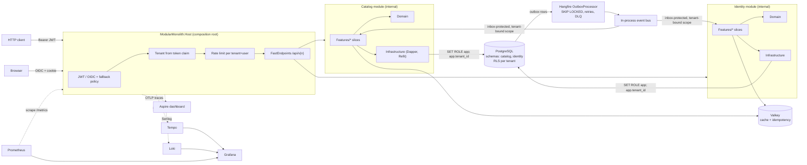

# ModularMonolith V1

A .NET 10 **modular monolith** template using **vertical slices** inside each module. Each module enforces clean-architecture dependency rules at its own boundary.

**Stack:**
- **Hosting:** ASP.NET Core with FastEndpoints, Aspire for local orchestration
- **Data:** PostgreSQL (Dapper, DbUp, row-level security) and Valkey
- **Messaging:** Hangfire runs a transactional outbox and inbox
- **Identity:** Keycloak over OpenID Connect and JWT
- **Observability:** OpenTelemetry, Serilog, Grafana, Tempo, Loki and Prometheus

Every dependency is free and open source (see [Third-party licenses](#third-party-licenses)).

---

## Quickstart

```powershell
# Build (warnings are errors, analyzers on)
dotnet build ModularMonolith.slnx

# Install as a `dotnet new` template
dotnet new install .
dotnet new modular-monolith -n MyCompany.Platform

# Run everything with Aspire (PostgreSQL, Valkey, Keycloak, LGTM, API)
# You'll be asked for the secret parameters in the dashboard, or set them once:
dotnet user-secrets --project src/Aspire/ModularMonolith.AppHost set "Parameters:postgres-password" "<pick one>"
dotnet user-secrets --project src/Aspire/ModularMonolith.AppHost set "Parameters:keycloak-admin-password" "<pick one>"
dotnet user-secrets --project src/Aspire/ModularMonolith.AppHost set "Parameters:grafana-admin-password" "<pick one>"
dotnet run --project src/Aspire/ModularMonolith.AppHost

# Or without Aspire (CI-like)
copy deploy\.env.example deploy\.env   # then edit the passwords
docker compose -f deploy/docker-compose.yml -f deploy/docker-compose.override.yml up --build
```

| Endpoint | Aspire | Compose |
|---|---|---|
| API | `http://localhost:5080` | `http://localhost:8081` |
| Swagger UI / OpenAPI contract (Development) | `/swagger`, `/swagger/v1/swagger.json` | same |
| Aspire dashboard | `https://localhost:15888` | n/a |
| Keycloak | `http://localhost:8080` | `http://localhost:8080` |
| Grafana / Prometheus / Loki / Tempo | see the Aspire dashboard | `:3000` / `:9090` / `:3100` / `:3200` |
| Hangfire dashboard (role `admin`) | `/hangfire` | `/hangfire` |

**Demo users** (dev realm only; the password is the username):

| User | Tenant | Roles |
|---|---|---|
| `alice` | `acme` | user, admin |
| `bob` | `acme` | user |
| `carol` | `globex` | user, admin |

`src/Host/ModularMonolith.Host/ModularMonolith.Host.http` contains a ready-made token request and smoke calls.

---

## Architecture



### Dependency rules

| Project | May reference |
|---|---|
| `Shared.Kernel` | nothing (pure C#) |
| `Shared.Infrastructure` | Kernel |
| `<Module>.Contracts` | Kernel only, as public versioned integration events |
| `<Module>` | Kernel, Shared.Infrastructure, its own Contracts, **other modules' Contracts only** |
| `Host` | Shared.Infrastructure, ServiceDefaults, module projects (it only uses `IModule` entry points) |

- Inside a module everything is `internal`. The single public type is the `IModule` entry point (`CatalogModule`, `IdentityModule`), so the compiler enforces module boundaries rather than convention.
- **Contracts are separated from implementation.**
  - Integration events live only in `*.Contracts`.
  - HTTP request and response DTOs are slice-local records.
  - Read models are separate from aggregates.
  - Domain events never leave their module.

### Request flow for a command

```
HTTP -> HTTP platform                            forwarded headers, HTTPS/HSTS, security headers, compression
     -> Authentication -> tenant -> timeout -> rate limit -> authorization
     -> Endpoint (FastEndpoints)                 thin adapter, Result -> RFC 9457 problem details
     -> IdempotencyPreProcessor                  optional Idempotency-Key (Valkey, tenant+user scoped)
     -> LoggingCommandDecorator
     -> TelemetryCommandDecorator                span + duration histogram
     -> ValidationCommandDecorator               FluentValidation -> 400 before any transaction
     -> TransactionalCommandDecorator            BEGIN
          -> CommandHandler                      business logic, returns Result<T>
          -> DomainEventDispatcher               in-module handlers (e.g. write to outbox)
          -> AuditWriter                         audit row in the same transaction
        COMMIT -> after-commit callbacks         cache invalidation, immediate outbox trigger
```

---

## Folder structure

```
ModularMonolithV1/
├── ModularMonolith.slnx
├── Directory.Build.props            # nullable, warnings-as-errors, analyzers, docs
├── Directory.Packages.props         # central package management + security pins
├── .editorconfig                    # formatting, style, naming, analyzer severities
├── global.json  NuGet.Config  Dockerfile  .dockerignore  LICENSE
├── .template.config/template.json   # `dotnet new modular-monolith`
├── deploy/
│   ├── docker-compose.yml  docker-compose.override.yml  .env.example
│   ├── keycloak/realm-export.json   # realm, clients, tenant_id + roles mappers, demo users
│   └── grafana/
│       ├── tempo.yaml  loki.yaml  prometheus.yaml  prometheus.aspire.yaml
│       └── provisioning/{datasources,dashboards}/...
└── src/
    ├── Aspire/
    │   ├── ModularMonolith.AppHost/            # Program.cs: containers, parameters, wiring
    │   └── ModularMonolith.ServiceDefaults/    # OTel, health endpoints, resilience
    ├── Host/ModularMonolith.Host/
    │   ├── Program.cs                          # composition root (module list lives here)
    │   ├── Configuration/                      # HttpPlatform, Security, Logging, BackgroundJobs, ApiConventions,
    │   │                                       # SecurityHeadersMiddleware, *Options + *OptionsValidator
    │   └── appsettings*.json  ModularMonolith.Host.http
    ├── Shared/
    │   ├── ModularMonolith.Shared.Kernel/      # pure building blocks
    │   │   ├── Domain/      Entity, AggregateRoot, IDomainEvent, IAuditable, ISoftDeletable
    │   │   ├── Results/     Result, Result<T>, Error, ValidationError, ErrorType
    │   │   ├── Paging/      PageRequest (validated), PagedResult<T>
    │   │   ├── Cqrs/        ICommand, IQuery, I*Handler, IDomainEventHandler
    │   │   ├── Messaging/   IIntegrationEvent, IIntegrationEventHandler, IOutbox
    │   │   └── Context/     ITenantContext, ICurrentUser
    │   └── ModularMonolith.Shared.Infrastructure/
    │       ├── Configuration/  AddValidatedOptions (bind + IValidateOptions + ValidateOnStart)
    │       ├── Serialization/  JsonDefaults (the single JSON convention)
    │       ├── Modules/        IModule, ModuleCatalog
    │       ├── Data/           DbSession (IDbSession + IUnitOfWork), SqlIdentifier, DatabaseOptions
    │       ├── Migrations/     ModuleMigrator (DbUp per module, advisory lock, grants)
    │       ├── Cqrs/           decorators, HandlerRegistration, DomainEventDispatcher, AuditWriter
    │       ├── Messaging/      Outbox, OutboxProcessor, InProcessEventBus, Inbox decorator, registry
    │       ├── Tenancy/        TenantContext, TenantResolutionMiddleware, TenancyOptions
    │       ├── Security/       HttpCurrentUser
    │       ├── Caching/        ICacheStore (keys + versioned regions), ValkeyCacheStore, CacheOptions
    │       ├── Idempotency/    FastEndpoints pre/post processors, Valkey store
    │       ├── Localization/   JSON IStringLocalizer per module assembly
    │       ├── Health/         PostgreSQL, Valkey checks
    │       ├── Observability/  ActivitySource/Meter, source-generated log messages
    │       └── Web/            Result -> ProblemDetails, ProblemResponses, PagingRequest, OpenAPI helpers
    └── Modules/
        ├── Catalog/
        │   ├── ModularMonolith.Catalog.Contracts/   ProductCreatedIntegrationEvent
        │   └── ModularMonolith.Catalog/
        │       ├── CatalogModule.cs                 # the only public type
        │       ├── CatalogOptions.cs  CatalogFeatures.cs
        │       ├── Domain/          Product, Money, ProductCreatedDomainEvent, CatalogErrors
        │       ├── Features/
        │       │   ├── CreateProduct/   Endpoint, Command, Handler, Validator, PublishProductCreated
        │       │   ├── GetProduct/      Endpoint, Query (+ read model), Handler (target of 201 Location)
        │       │   ├── ListProducts/    Endpoint, Query (+ read model), Handler (paged, cached per page)
        │       │   ├── GetProductPrice/ Endpoint, Query, Handler (currency conversion)
        │       │   └── SyncSeller/      UserRegisteredHandler (consumes Identity's event)
        │       ├── Infrastructure/  ProductRepository, ExchangeRates/ (Refit + ACL), Migrations/001_catalog.sql
        │       └── Resources/Catalog.en.json
        └── Identity/
            ├── ModularMonolith.Identity.Contracts/  UserRegisteredIntegrationEvent
            └── ModularMonolith.Identity/
                ├── IdentityModule.cs  IdentityOptions.cs  IdentityFeatures.cs
                ├── Domain/          UserProfile, UserRegisteredDomainEvent, IdentityErrors
                ├── Features/        RegisterUser/, GetCurrentUser/, ListUsers/
                ├── Infrastructure/  UserProfileRepository, Keycloak/ (Refit + health check), Migrations/
                └── Resources/Identity.en.json
```

---

## Example classes (commented)

These are condensed from the real sources so the patterns are visible in one place.

### 1. Aggregate: invariants live in the domain

```csharp
// src/Modules/Catalog/ModularMonolith.Catalog/Domain/Product.cs
internal sealed partial class Product : AggregateRoot          // internal: invisible outside the module
{
    public const int MaxNameLength = 200;

    private Product(Guid id, string name, string sku, Money price, string sellerId) : base(id) { /* assign */ }

    public string Name { get; }
    public string Sku { get; }
    public Money Price { get; }                                  // value object: amount > 0, ISO currency
    public string SellerId { get; }

    // Factory returns Result<T> instead of throwing: invalid products cannot exist,
    // whichever entry point creates them (HTTP, message handler, test).
    public static Result<Product> Create(string? name, string? sku, decimal amount, string? currency,
                                         string sellerId, DateTimeOffset now)
    {
        if (string.IsNullOrWhiteSpace(name) || name.Trim().Length > MaxNameLength)
            return Result.Failure<Product>(CatalogErrors.NameInvalid);
        // ... SKU and Money validation ...
        var product = new Product(Guid.CreateVersion7(now), name.Trim(), normalizedSku, price.Value, sellerId);

        // Domain event: dispatched by the unit of work INSIDE the same transaction.
        product.Raise(new ProductCreatedDomainEvent(Guid.CreateVersion7(now), now, product.Id, /* ... */));
        return Result.Success(product);
    }
}
// Note: there is no TenantId on the entity. Tenancy is enforced by PostgreSQL RLS.
```

### 2. A complete vertical slice: `Features/CreateProduct`

```csharp
// Command: what the slice does. ICommand<T> = runs in a transaction and is audited.
internal sealed record CreateProductCommand(string Name, string Sku, decimal Price, string Currency) : ICommand<Guid>;

// Validator: fast input checks with localized messages; runs before any transaction is opened.
internal sealed class CreateProductCommandValidator : AbstractValidator<CreateProductCommand>
{
    public CreateProductCommandValidator(IStringLocalizer<CatalogModule> localizer)   // Resources/Catalog.en.json
    {
        RuleFor(c => c.Name).NotEmpty().WithMessage(_ => localizer["NameRequired"]);
        RuleFor(c => c.Price).GreaterThan(0).WithMessage(_ => localizer["PriceInvalid"]);
    }
}

// Handler: pure business flow. No HTTP, no SQL transactions, no outbox or audit code (those are decorators).
internal sealed class CreateProductCommandHandler(
    IProductRepository products, ICurrentUser currentUser,
    IFeatureManager features, TimeProvider clock) : ICommandHandler<CreateProductCommand, Guid>
{
    public async Task<Result<Guid>> HandleAsync(CreateProductCommand command, CancellationToken ct)
    {
        if (await features.IsEnabledAsync(CatalogFeatures.WriteDisabled, ct))
            return Result.Failure<Guid>(CatalogErrors.WritesDisabled);              // -> 503
        if (await products.SkuExistsAsync(command.Sku, ct))
            return Result.Failure<Guid>(CatalogErrors.SkuTaken);                    // -> 409

        var created = Product.Create(command.Name, command.Sku, command.Price, command.Currency,
                                     currentUser.AuditId, clock.GetUtcNow());
        if (created.IsFailure) return Result.Failure<Guid>(created.Error);          // -> 400

        await products.AddAsync(created.Value, ct);   // joins the unit of work; tracks the aggregate
        return Result.Success(created.Value.Id);
    }
}

// Endpoint: thin HTTP adapter. The handler is injected directly; there is no mediator.
internal sealed class CreateProductEndpoint(ICommandHandler<CreateProductCommand, Guid> handler)
    : Endpoint<CreateProductRequest, CreateProductResponse>
{
    public override void Configure()
    {
        Post("catalog/products");                    // -> POST /api/v1/catalog/products
        Version(1);
        Options(b => b.WithTags("Catalog").RequireRateLimiting(RateLimitPolicies.PerUser));
        PreProcessor<IdempotencyPreProcessor<CreateProductRequest>>();                         // Idempotency-Key
        PostProcessor<IdempotencyPostProcessor<CreateProductRequest, CreateProductResponse>>();
        Description(b => b                           // OpenAPI: every success and problem response is documented
            .Produces<CreateProductResponse>(StatusCodes.Status201Created)
            .ProducesProblems(400, 403, 409, 422, 503), clearDefaults: true);   // + 401 and 429 automatically
    }

    public override async Task HandleAsync(CreateProductRequest req, CancellationToken ct)
    {
        var result = await handler.HandleAsync(new CreateProductCommand(req.Name, req.Sku, req.Price, req.Currency), ct);
        if (result.IsFailure) { await Send.ResultAsync(result.Error.ToProblem()); return; }   // RFC 9457
        HttpContext.Response.Headers.Location = GetProductEndpoint.LocationFor(result.Value);  // /api/v1/catalog/products/{id}
        await Send.ResponseAsync(new CreateProductResponse(result.Value), StatusCodes.Status201Created, ct);
    }
}

// Slice-local DTOs: never shared with other slices or modules.
internal sealed record CreateProductRequest(string Name, string Sku, decimal Price, string Currency);
internal sealed record CreateProductResponse(Guid Id);
```

### 3. Domain event to integration event, through the outbox, in one transaction

```csharp
// Features/CreateProduct/PublishProductCreated.cs
internal sealed class PublishProductCreated(IOutbox outbox, ITenantContext tenant, IUnitOfWork uow, ICacheStore cache)
    : IDomainEventHandler<ProductCreatedDomainEvent>
{
    public async Task HandleAsync(ProductCreatedDomainEvent e, CancellationToken ct)
    {
        // Written to catalog.outbox_messages in the SAME transaction as the product row:
        // the event exists if and only if the product was committed.
        await outbox.AddAsync(new ProductCreatedIntegrationEvent(
            e.EventId, e.OccurredAt, tenant.TenantId, e.ProductId, e.Name, e.Sku, e.Price, e.Currency, e.SellerId), ct);

        // Side effects that must only happen after a successful commit.
        uow.OnCommitted(token => cache.RemoveAsync(ListProductsQueryHandler.CacheKey, token));
    }
}
```

### 4. Cross-module consumer: Catalog reacts to Identity

```csharp
// Features/SyncSeller/UserRegisteredHandler.cs
// Catalog references ONLY ModularMonolith.Identity.Contracts, never Identity internals or tables.
internal sealed class UserRegisteredHandler(IDbSession session) : IIntegrationEventHandler<UserRegisteredIntegrationEvent>
{
    public async Task HandleAsync(UserRegisteredIntegrationEvent e, CancellationToken ct)
    {
        // The event bus runs this in a fresh scope bound to e.TenantId, in its own transaction,
        // behind an inbox row (message_id, handler). Redelivery is a no-op.
        var connection = await session.GetConnectionAsync(ct);
        await connection.ExecuteAsync(new CommandDefinition("""
            insert into catalog.sellers (subject_id, display_name, email, registered_at)
            values (@SubjectId, @DisplayName, @Email, @OccurredAt)
            on conflict (tenant_id, subject_id) do update set display_name = excluded.display_name
            """, e, session.Transaction, cancellationToken: ct));
    }
}
```

### 5. Module entry point: the only public type

```csharp
// src/Modules/Catalog/ModularMonolith.Catalog/CatalogModule.cs
public sealed class CatalogModule : IModule
{
    public string Name => "Catalog";
    public string Schema => "catalog";                                   // schema owned by this module only
    public Assembly Assembly => typeof(CatalogModule).Assembly;          // endpoints, handlers, validators, SQL
    public Assembly ContractsAssembly => typeof(ProductCreatedIntegrationEvent).Assembly;

    // Handlers, validators and endpoints are discovered by scanning. Register only module infrastructure here.
    public void AddServices(IServiceCollection services, IConfiguration configuration)
    {
        services.AddOptions<CatalogOptions>().Bind(configuration.GetSection("Modules:Catalog")).ValidateOnStart();
        services.AddScoped<IProductRepository, ProductRepository>();
        services.AddRefitClient<IExchangeRatesApi>() /* base address from options */;
    }
}

// Host: the single place where modules are composed.
IModule[] modules = [new CatalogModule(), new IdentityModule()];
builder.Services.AddSharedInfrastructure(builder.Configuration, modules);
builder.Services.AddFastEndpoints(o => { o.Assemblies = modules.Select(m => m.Assembly); o.DisableAutoDiscovery = true; });
```

### 6. Migration with row-level security

```sql
-- src/Modules/Catalog/ModularMonolith.Catalog/Infrastructure/Migrations/001_catalog.sql
create table catalog.products (
    id        uuid primary key,
    -- Filled from the session variable; '' or NULL (no tenant) can never be inserted.
    tenant_id text not null default current_setting('app.tenant_id', true) check (tenant_id <> ''),
    name      varchar(200) not null,
    sku       varchar(64)  not null,
    price     numeric(18, 2) not null check (price > 0)
    -- ...
);
create unique index ux_products_tenant_sku on catalog.products (tenant_id, sku) where not is_deleted;

alter table catalog.products enable row level security;
alter table catalog.products force row level security;   -- applies to the table owner too
create policy tenant_isolation on catalog.products
    using      (tenant_id = current_setting('app.tenant_id', true))  -- reads
    with check (tenant_id = current_setting('app.tenant_id', true)); -- writes
```

---

## Multi-tenancy model

1. **Tenant resolution.** The tenant comes from the validated `tenant_id` claim of the access token, set by a Keycloak user-attribute mapper. Users can't edit that attribute.
   - With `Tenancy:RootDomain` set, a subdomain is used only to cross-check the claim. A mismatch returns 403.
   - The `Host` header is never trusted on its own.
2. **Fail closed.**
   - An authenticated request without a tenant claim gets 403.
   - `Tenancy:AllowDefaultTenant` exists for local experiments only.
3. **Database enforcement.** Every application connection runs `SET ROLE modular_monolith_app` and `set_config('app.tenant_id', …)`.
   - The role is a `NOLOGIN`, non-superuser role that owns nothing, so PostgreSQL RLS applies even when the login is a superuser in development.
   - A bug that forgets a `WHERE tenant_id = …` still can't leak data.
4. **Schema per module, not per tenant.** One migration run covers all tenants. There are no schema-name collisions and no per-tenant provisioning.
5. **Caches and idempotency keys** are prefixed with the tenant (and the user for idempotency).

> **Production note:** connect with a non-superuser login that is a member of `modular_monolith_app` (`grant modular_monolith_app to <login>`). Run migrations with the schema owner.

## Messaging guarantees

| Concern | Mechanism |
|---|---|
| Event published if and only if the change commits | Transactional outbox in the publisher's schema, written by in-transaction domain-event handlers |
| Low latency | An immediate Hangfire job is enqueued after commit; a recurring sweep (`Outbox:SweepCron`) is the safety net |
| Multiple replicas | Rows are claimed with `FOR UPDATE SKIP LOCKED`; migrations run under `pg_advisory_lock` |
| All tenants drained | The outbox table has no RLS; each message carries `tenant_id`, and consumers run in a scope bound to it |
| Retries | In-process retry (3), then exponential backoff (`next_attempt_at`), then `status = 'dead'` after `Outbox:MaxAttempts` |
| Exactly-once effect per consumer | Inbox `(message_id, handler)` is inserted in the consumer's transaction; handlers that already succeeded are skipped on redelivery |
| Safe deserialization | Only types exported by registered `*.Contracts` assemblies can be loaded; there is no `dynamic` dispatch |

## Observability (one pipeline per signal)

- **Traces** go out over OTLP: to the Aspire dashboard under Aspire, and to Tempo under compose. `Observability:TempoEndpoint` adds Tempo alongside the dashboard.
- **Metrics** are OpenTelemetry metrics exposed at `/metrics` for Prometheus. They can also be pushed over OTLP to the Aspire dashboard when `Observability:OtlpMetrics=true`.
- **Custom metrics:**
  - `modmono.handler.duration`
  - `modmono.outbox.processed`
  - `modmono.outbox.failed`
  - `modmono.outbox.dead_lettered`
- **Logs** go through Serilog to the console and to Loki (`Observability:LokiUrl`). They also go to OTLP when `Observability:OtlpLogs=true`. Trace and span ids are included.
- **Grafana** datasources are provisioned with fixed UIDs and these links: Tempo → Loki, Loki → Tempo, Prometheus exemplars → Tempo. A starter dashboard is included.

## Security

- **API (`/api/*`):** JWT bearer with an audience check (`modular-monolith-api`). It returns 401 and never redirects.
- **Browser (`/hangfire`):** cookie plus OpenID Connect. The `modular-monolith-web` client is public and uses PKCE, so there's no client secret.
- **Defaults:**
  - The fallback policy requires authentication everywhere.
  - `/health/*` and `/metrics` opt out explicitly.
  - The Hangfire dashboard requires role `admin`.
- **Rate limiting:** a fixed window per tenant and user, falling back to the client IP.
- **Secrets:**
  - Aspire uses secret parameters.
  - Compose uses `deploy/.env`, which is git-ignored.
  - Only local-development defaults are committed (`appsettings.Development.json`, dev realm demo users).

---

## API conventions

| Concern | Convention |
|---|---|
| Routes and versioning | `/api/v{n}/<module>/<resource>` (FastEndpoints versioning, nouns only) |
| JSON | One configuration (`JsonDefaults`) for HTTP, outbox, cache and idempotency: camelCase, enums as camelCase strings, strict numbers, nulls written explicitly |
| Errors | Always RFC 9457 problem details with `traceId`; human-readable `title`, occurrence-specific `detail`, stable `code` extension. This covers `Result` errors, binding and validation errors, 401, 403, 404, 405, 413, 429 and 504 |
| Validation | 400 with `errors: { field: [messages] }`, the same shape for request binding errors and command validation |
| Status codes | 200, 201 (+ `Location` of the new resource), 400, 401, 403, 404, 409, 413, 422 (idempotency key reuse), 429 (+ `Retry-After`), 503 (feature disabled / dependency down), 504 (timeout) |
| Lists | Always paged: `?page=1&pageSize=20` (max 100), response `{ items, page, pageSize, totalCount, totalPages, hasNextPage, hasPreviousPage }`, deterministic ordering |
| Limits | Request timeout `Http:RequestTimeoutSeconds` (504), body size `Http:MaxRequestBodyBytes` (413), rate limit per tenant + user (429) |
| Idempotency | Optional `Idempotency-Key` header on POST |
| OpenAPI | Every endpoint documents its success and problem responses; the contract is served in Development at `/swagger/v1/swagger.json` (Swagger UI is never exposed outside Development) |
| Transport | Outside Development: HTTPS redirection (308) and HSTS, except `/health/*` and `/metrics`; `X-Forwarded-*` honoured only from `ReverseProxy:KnownProxies` / `KnownNetworks`; secure-only cookies |
| Headers | `X-Content-Type-Options`, `X-Frame-Options`, `Referrer-Policy`, `Permissions-Policy`, `Cross-Origin-Opener-Policy`, and a CSP (locked down for JSON, relaxed only for the Hangfire and Swagger UIs); no `Server` header; Brotli/gzip compression |

## Configuration

Every section is a strongly typed options class with an `IValidateOptions<T>` validator and `ValidateOnStart()`, so the host refuses to start on missing or invalid settings and lists every problem.

| Section | Validated rules |
|---|---|
| `ConnectionStrings:postgres`, `ConnectionStrings:cache` | Must be present (names configurable in `Database` / `Cache`) |
| `Database` | Connection string name set; `ApplicationRole` is a lowercase SQL identifier |
| `Authentication` | `Authority` is an absolute URL, https unless `RequireHttpsMetadata=false` (development only); audience and web client id set |
| `Tenancy` | Claim type set; valid default tenant when the fallback is enabled; `RootDomain` is a host name |
| `Outbox` | Batch size, batches per run, attempts and delays within range; cron has 5 or 6 fields |
| `Localization` | At least one known culture |
| `RateLimiting` | Permit limit and window within range |
| `Http` | Timeout, body size, HTTPS port and HSTS max-age within range |
| `ReverseProxy` | Proxies are IP addresses, networks are CIDR ranges, forward limit 1–10 |
| `Modules:Catalog`, `Modules:Identity` | Cache TTLs within range; URLs are absolute http(s) |

Behind a TLS-terminating load balancer or ingress, set `ReverseProxy__KnownNetworks__0=<ingress CIDR>` so the client IP (rate limiting, audit) and the https scheme are taken from `X-Forwarded-*`.

---

## How to add …

### … a slice to an existing module

1. Create `Features/<UseCase>/`.
2. Add a `…Command : ICommand<T>` or `…Query : IQuery<T>`, a handler, an optional `AbstractValidator<…>`, and a FastEndpoints endpoint with slice-local request and response records. List queries take a `PageRequest` and return `PagedResult<T>`; endpoints document their responses with `Description(... .ProducesProblems(...), clearDefaults: true)`.
3. That's all. Handlers and validators are picked up by assembly scanning and wrapped by the decorator chain automatically.

### … a module

1. Create `src/Modules/<Name>/ModularMonolith.<Name>` and `ModularMonolith.<Name>.Contracts`. Copy a csproj; reference Kernel, Shared.Infrastructure and only other modules' `*.Contracts`.
2. Add a public `<Name>Module : IModule` with a unique `Schema`.
3. Add `Infrastructure/Migrations/001_<name>.sql` with the tables. Include `tenant_id` and the RLS policy, plus `outbox_messages`, `inbox_messages` and `audit_log` (copy them from Catalog).
4. Add `new <Name>Module()` to the module list in `Host/Program.cs` and a project reference in the Host csproj.

---

## Build and code-quality settings

| Setting | Where |
|---|---|
| `Nullable`, `ImplicitUsings`, `TreatWarningsAsErrors`, `AnalysisLevel=latest-recommended`, `EnforceCodeStyleInBuild`, `GenerateDocumentationFile`, deterministic and CI builds | `Directory.Build.props` |
| `TargetFramework` and `LangVersion` pinned explicitly | every `.csproj` |
| Central package versions, transitive security pins (`Newtonsoft.Json`, `MessagePack`) | `Directory.Packages.props` |
| Meziantou.Analyzer for every project | `GlobalPackageReference` |
| File-scoped namespaces (error), formatting (IDE0055), unused usings (IDE0005), braces, naming | `.editorconfig` |
| Justified analyzer overrides (DI-created internals, no `ConfigureAwait` in ASP.NET Core, …) | bottom of `.editorconfig` |

## Third-party licenses

All free for commercial use. There are no paid tiers and no commercial-licensed packages (no MediatR v13+, AutoMapper v15+, MassTransit v9+, FluentAssertions v8+, Duende, Hangfire Pro).

| Component | License |
|---|---|
| .NET, ASP.NET Core, Aspire, Microsoft.FeatureManagement, Microsoft.Extensions.* | MIT |
| OpenTelemetry .NET | Apache-2.0 |
| FastEndpoints (+ Swagger, NSwag) | MIT |
| Dapper | Apache-2.0 |
| Npgsql | PostgreSQL License |
| DbUp | MIT |
| FluentValidation | Apache-2.0 |
| Refit | MIT |
| Serilog (+ sinks) | Apache-2.0 |
| StackExchange.Redis | MIT |
| Hangfire.Core, Hangfire.AspNetCore, Hangfire.PostgreSql | LGPL-3.0 (free) |
| Meziantou.Analyzer | MIT |
| PostgreSQL | PostgreSQL License |
| Valkey (instead of Redis, whose 7.4+ licenses are not OSI open source) | BSD-3-Clause |
| Keycloak | Apache-2.0 |
| Prometheus | Apache-2.0 |
| Grafana, Loki, Tempo (self-hosted OSS) | AGPL-3.0 |
